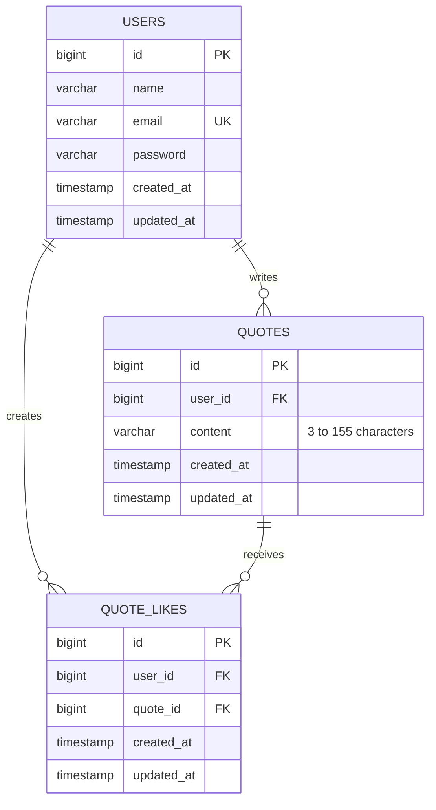

# SPACE — Quotes Website

SPACE is a Laravel quote-sharing website with a soft celestial / sage visual identity.

## Requirements

- PHP 8.3 or newer
- Composer
- Node.js and npm
- A database supported by Laravel (SQLite or MySQL)

## Run locally

1. Install PHP dependencies:

   ```bash
   composer install
   ```

2. Create your environment file and app key:

   ```bash
   cp .env.example .env
   php artisan key:generate
   ```

3. Configure the database in `.env`.

   For SQLite, create the database file:

   ```bash
   touch database/database.sqlite
   ```

   Then set:

   ```env
   DB_CONNECTION=sqlite
   ```

   For MySQL, set `DB_CONNECTION`, `DB_HOST`, `DB_PORT`, `DB_DATABASE`, `DB_USERNAME`, and `DB_PASSWORD`.

4. Run migrations:

   ```bash
   php artisan migrate
   ```

5. Install frontend dependencies and build assets:

   ```bash
   npm install
   npm run build
   ```

6. Start Laravel:

   ```bash
   php artisan serve
   ```

## Main features

- Guests can browse public quotes.
- Users can register, log in, and log out.
- Authenticated users can publish, edit, and delete their own quotes.
- Quotes must contain 3–155 characters.
- Users can like other users' quotes and view their saved likes in **Your Likes**.
- Users can view their own posts in **Your SPACE**.
- Passwords are hashed by Laravel's `hashed` cast.
- Edit and delete operations are restricted to the quote owner.
- Like records are unique per user/quote pair.

## Database

The database is defined by Laravel migrations in `database/migrations/`.

- `users`: account details.
- `quotes`: quote text and its owner.
- `quote_likes`: many-to-many relationship between users and liked quotes.

An SQL reference schema is available in `database/SPACE_DATABASE.sql`.

### ERD



## Responsive layout

- Small phones: one quote card per row.
- Phones and tablets: two quote cards per row.
- Laptops and wider screens: three quote cards per row.
- Forms and navigation adapt to smaller screens.

## Notes

Do not commit `.env`, database credentials, or production secrets. The `.env` file is intentionally excluded from the project ZIP. Generate a fresh application key for each environment.
